<a href="https://earthclique.in"></a>

  

  
  
  
  

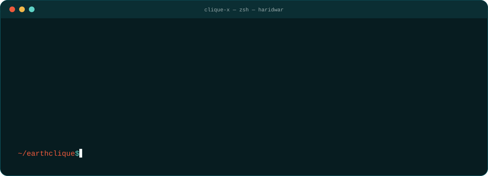

 


  <a href="https://casecraft-store.vercel.app"></a>
  <a href="https://github.com/clique-x/earthclique"></a>
  <a href="https://github.com/clique-x/earthcliqueamc"></a>
  <a href="https://github.com/clique-x/swasthik-website"></a>
  <a href="https://github.com/clique-x/CodaMusica"></a>
  <a href="https://earthclique.in"></a>


 


   
   
  


  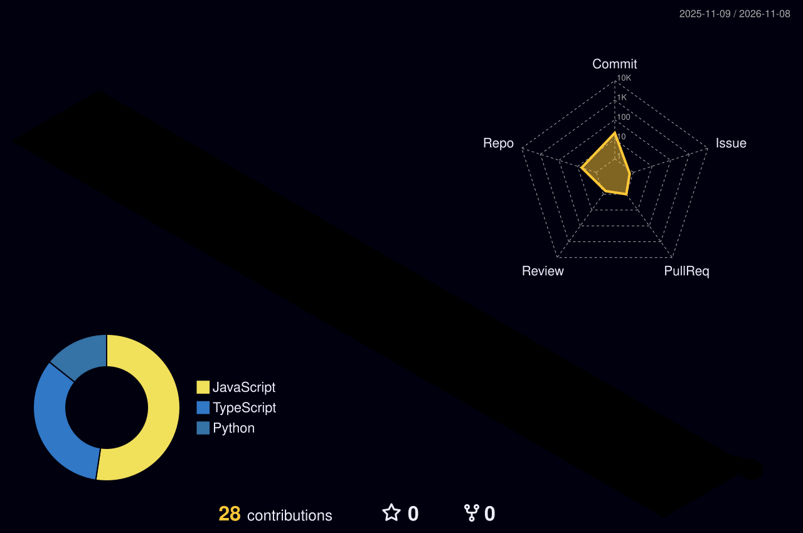

  

<a href="https://earthclique.in">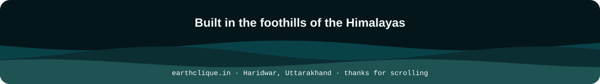</a>

<!-- Assets generated by gen/build.py — real 3D wireframes, projected per frame and played back with SVG SMIL. -->
